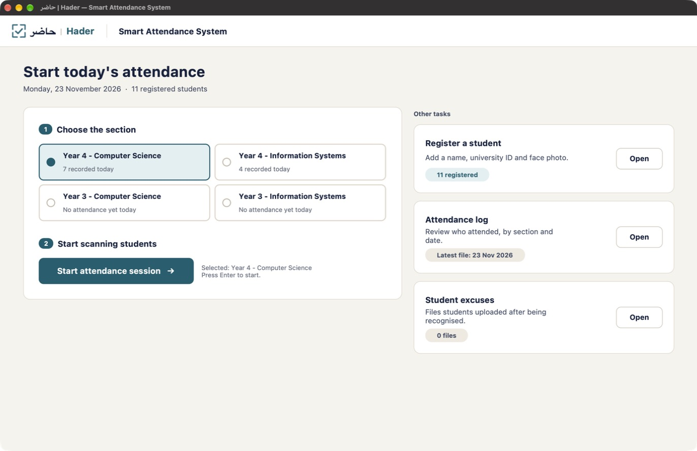
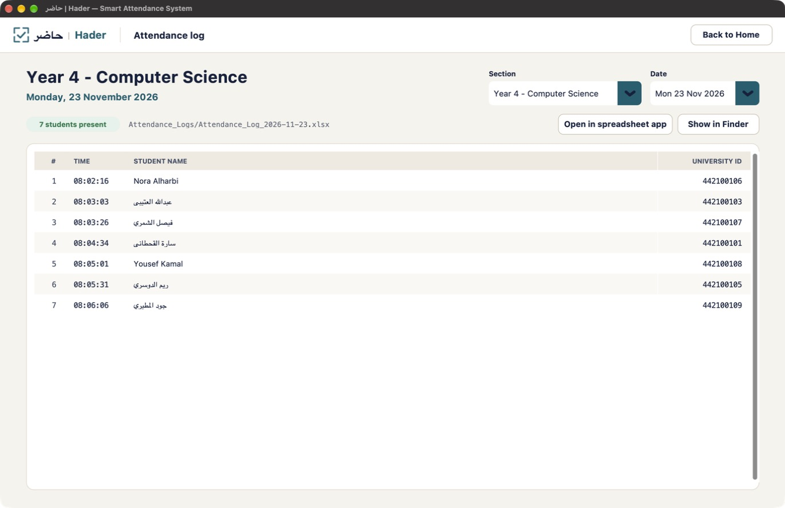

# Smart Attendance System

**حاضر | Hader** — the app's display name.



A Python-based desktop application developed as a graduation project to automate student attendance using facial recognition.

The system recognizes registered students through the camera and automatically records their name, student ID, attendance date, and time in an Excel file. It also provides an instructor interface for registering students, selecting sections, reviewing attendance records, and checking submitted excuses.

## Features

* Student registration with facial data
* Real-time face recognition through the camera
* Automatic attendance recording
* Records student name, ID, date, and time
* Attendance data stored in Excel
* Section selection and management
* Attendance records review
* Student excuses review
* Simple desktop user interface

## Technologies Used

* Python
* OpenCV
* face_recognition
* CustomTkinter
* Pillow
* NumPy
* Excel

## How It Works

1. The instructor registers the student and captures their facial data.
2. The student uses the camera to confirm attendance.
3. The system compares the detected face with the registered students.
4. When the student is recognized, their attendance information is automatically recorded.
5. The instructor can review the attendance records and student excuses.

## Installation

1. Clone the repository:

```bash
git clone https://github.com/lolo67fa/Smart-Attendance-System.git
```

2. Open the project folder:

```bash
cd Smart-Attendance-System
```

3. Install the required libraries:

```bash
pip install -r requirements.txt
```

4. Run the application:

```bash
python main.py
```

## Requirements

* Python 3.12 (tested with 3.12.16)
* A working camera
* The required Python libraries listed in `requirements.txt`

## Running on macOS (Apple Silicon) — tested

These exact commands were tested on an M-series MacBook Air with a fresh environment.
`dlib` has no prebuilt wheel for Apple Silicon, so pip compiles it; that needs Xcode
Command Line Tools and Homebrew's `libpng` (dlib's bundled copy of libpng does not
compile with the current macOS SDK: `fatal error: 'fp.h' file not found`).

```bash
xcode-select --install          # skip if Xcode or the Command Line Tools are installed
brew install libpng
```

```bash
# Python 3.12 via uv (https://docs.astral.sh/uv/); python.org's 3.12 installer also works
uv python install 3.12
uv venv --seed --python 3.12 .venv
source .venv/bin/activate
pip install -r requirements.txt   # compiling dlib takes a few minutes
python main.py
```

The first launch takes about 30 seconds while the face models load.
Instructor passcode: `1234` (set in `ui/theme.py`).

**Camera permission:** macOS asks for camera access the first time the app opens the
camera. Run `python main.py` from Terminal and click **Allow** ("Terminal would like to
access the camera"). If you clicked "Don't Allow" earlier, enable Terminal under
System Settings → Privacy & Security → Camera, then restart Terminal.

## Where the data is saved

All files are created in the folder you run the app from:

| What | File |
| --- | --- |
| Registered students (ID, name, photo IDs) | `Student_Data.xlsx` |
| Student face photos | `db/<photo id>.jpg` |
| Daily attendance | `Attendance_Logs/Attendance_Log_YYYY-MM-DD.xlsx` |
| Uploaded excuses | `Student_Excuses_Files/<section>/<id>_<name>/` |

Each attendance row has: `University ID`, `Student Name`, `Attendance Date` (YYYY-MM-DD),
`Attendance Time` (HH:MM:SS) and `Section`. A new file is created each day. A student is
recorded once per section per day: scanning them again shows "Already recorded today"
and writes nothing.

## Using the app

1. **Home** — choose the section and press **Start attendance session** (Enter).
   The instructor passcode (`1234`, in `ui/theme.py`) is asked once per run.
   If no students are registered yet, Home asks you to register one first.
2. **Session** — students look at the camera one at a time. Scanning starts by itself
   when one face is steady (or press Space / **Scan now**). "Attendance recorded" appears
   only after the row has been read back from the day's Excel file; the list on the right
   shows everyone recorded today in that section. Esc ends the session.
3. **Register a student** — full name → university ID → face photo (camera or image
   file) → Save. Errors appear next to the field; typed values stay when you retake.
4. **Attendance log** — pick section and date; open the file in Excel/Numbers or show it
   in Finder.
5. **Student excuses** — files students uploaded after being recognised.

Keyboard: Tab moves between controls (focused controls get a dark ring),
Space/Enter activates them, Esc goes back.




## Demo mode and test data (no camera needed)

`tools/demo_walkthrough.py` runs the real app and checks a full journey on its own:
register a test student from an image → choose a section → start the session → the face
is recognised and recorded → a second scan is refused as a duplicate → the log shows the
saved row → "no camera" and "camera access denied" states. Only the camera is simulated
(the test image is served as the camera frame); the window is labelled
**DEMO MODE · simulated camera · test data** and all data goes to `demo_data/`.

```bash
python tools/demo_walkthrough.py --face path/to/test_face.jpg --fast
python tools/demo_walkthrough.py --face path/to/test_face.jpg --interactive   # use it by hand
```

It prints PASS/FAIL for each check and exits with code 0 when everything passed.
Use a photo of someone who agreed to it (for example yourself).

`tools/seed_demo_data.py` fills a folder with fictional students and attendance (no real
faces) for screenshots:

```bash
python tools/seed_demo_data.py --data-dir demo_data --wipe
cd demo_data && python ../main.py
```

## Project Purpose

The purpose of this project is to replace manual attendance methods with a faster and more accurate system. Facial recognition reduces attendance errors, saves instructors’ time, and provides organized digital attendance records.

## Author : ghala alshreef

**Ghala Ahmad Alshreef**
Information Technology Graduate
