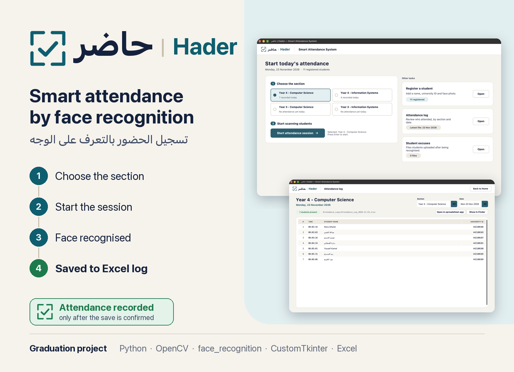
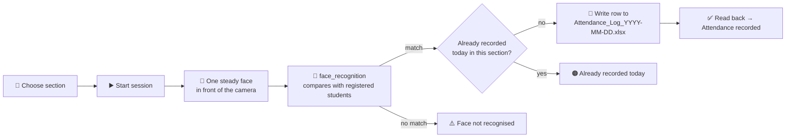

<div align="center">


# حاضر | Hader

### Smart Attendance System

**Students look at the camera — attendance is recorded, saved to Excel, and ready to review.**

A desktop app that recognises registered students by face and records their attendance
per section in a daily Excel file. Built as a graduation project.




</div>

---

## ✨ Features

| | |
|---|---|
| 🏫 **Start in two steps** | Choose the section, press **Start attendance session**. That's the whole setup. |
| 📸 **Hands-free scanning** | Scanning starts on its own when one face is steady in front of the camera. |
| ✅ **Honest confirmation** | "Attendance recorded" appears only after the row has been read back from the Excel file. |
| 🚫 **No duplicates** | A student is recorded once per section per day — a second scan shows "Already recorded today". |
| 📋 **Live list** | Everyone recorded today in the section appears next to the camera, with their time. |
| 🧑‍🎓 **Easy registration** | Name → university ID → face photo (camera or image file), with errors shown next to each field. |
| 📂 **Attendance log** | Pick a section and a date; open the Excel file or show it in Finder / Explorer. |
| 📎 **Student excuses** | Students upload an excuse after being recognised; instructors review them in one list. |
| 🎥 **Clear camera states** | Starting, ready, camera blocked by macOS, or no camera — each with the next step. |
| ⌨️ **Keyboard-friendly** | Tab between controls (visible focus ring), Space / Enter to act, Esc to go back. |

## 🖼️ Screenshots

<table>
<tr>
<td width="50%"></td>
<td width="50%"></td>
</tr>
<tr>
<td align="center"><b>Home</b> — choose the section, start the session</td>
<td align="center"><b>Attendance log</b> — by section and date</td>
</tr>
</table>

<sub>Screenshots use fictional test data.</sub>

## 🧠 How it works



## 🚀 Getting started

### Windows

```bash
git clone https://github.com/lolo67fa/Smart-Attendance-System.git
cd Smart-Attendance-System
pip install -r requirements.txt
python main.py
```

### macOS (Apple Silicon) — tested on an M-series MacBook Air

`dlib` has no prebuilt wheel for Apple Silicon, so pip compiles it. That needs the Xcode
Command Line Tools and Homebrew's `libpng` (dlib's bundled libpng does not compile with
the current macOS SDK: `fatal error: 'fp.h' file not found`).

```bash
xcode-select --install          # skip if Xcode or the Command Line Tools are installed
brew install libpng
```

```bash
# Python 3.12 via uv (https://docs.astral.sh/uv/); python.org's 3.12 installer also works
uv python install 3.12
uv venv --seed --python 3.12 .venv
source .venv/bin/activate
pip install -r requirements.txt   # compiling dlib takes a few minutes
python main.py
```

- The first launch takes about 30 seconds while the face models load.
- Instructor passcode: `1234` (set in `ui/theme.py`), asked once per run.
- **Camera permission:** macOS asks the first time the app opens the camera. Run
  `python main.py` from Terminal and click **Allow**. If you clicked "Don't Allow" earlier,
  enable Terminal in System Settings → Privacy & Security → Camera, then restart Terminal.

**Requirements:** Python 3.12 (tested with 3.12.16), a camera (or an image file for
registration), and the libraries in `requirements.txt`.

## 🧭 Using the app

1. **Home** — choose the section and press **Start attendance session** (Enter).
   If no students are registered yet, Home asks you to register one first.
2. **Session** — students look at the camera one at a time. Scanning starts by itself
   when one face is steady (or press Space / **Scan now**). Esc ends the session.
3. **Register a student** — full name → university ID → face photo → **Save student**.
   Typed values stay when you retake the photo.
4. **Attendance log** — pick the section and date; open the file in Excel / Numbers.
5. **Student excuses** — open any uploaded file, or the whole folder.

## 💾 Where the data is saved

All files are created in the folder you run the app from:

| What | File |
| --- | --- |
| Registered students (ID, name, photo IDs) | `Student_Data.xlsx` |
| Student face photos | `db/<photo id>.jpg` |
| Daily attendance | `Attendance_Logs/Attendance_Log_YYYY-MM-DD.xlsx` |
| Uploaded excuses | `Student_Excuses_Files/<section>/<id>_<name>/` |

Each attendance row has `University ID`, `Student Name`, `Attendance Date` (YYYY-MM-DD),
`Attendance Time` (HH:MM:SS) and `Section`. A new file is created each day.

## 🧪 Demo mode and test data (no camera needed)

`tools/demo_walkthrough.py` runs the real app and checks a full journey on its own:
register a test student from an image → choose a section → start the session → the face
is recognised and recorded → a second scan is refused as a duplicate → the log shows the
saved row → "no camera" and "camera access denied" states. Only the camera is simulated;
the window is labelled **DEMO MODE · simulated camera · test data** and all data goes to
`demo_data/`.

```bash
python tools/demo_walkthrough.py --face path/to/test_face.jpg --fast
python tools/demo_walkthrough.py --face path/to/test_face.jpg --interactive   # use it by hand
```

It prints PASS/FAIL for each check and exits with code 0 when everything passed.
Use a photo of someone who agreed to it (for example yourself).

`tools/seed_demo_data.py` fills a folder with fictional students and attendance (no real
faces) for screenshots:

```bash
python tools/seed_demo_data.py --data-dir demo_data --wipe
cd demo_data && python ../main.py
```

## 📁 Project structure

```
├── main.py                  # App window, screen navigation, instructor passcode
├── screens/
│   ├── home_screen.py       # Choose section, start session, other tasks
│   ├── session_screen.py    # Camera, auto-scan, status states, today's list
│   ├── register_screen.py   # Name → ID → photo, inline errors
│   ├── log_screen.py        # Attendance by section and date
│   └── excuses_screen.py    # Uploaded excuses
├── ui/
│   ├── theme.py             # Colours, type, spacing, sections, constants
│   ├── components.py        # Shared buttons, cards, tables, notices, dialogs
│   └── brand.py             # The Hader mark (scan frame + check)
├── core/
│   ├── camera.py            # Camera access + macOS permission status
│   ├── face_engine.py       # Face detection and recognition
│   ├── data_manager.py      # Excel read/write
│   └── platform_utils.py    # Open files / folders on any OS
└── tools/                   # Demo walkthrough and fictional seed data
```

## 🛠️ Built with

**Python** · **OpenCV** · **face_recognition (dlib)** · **CustomTkinter** · **pandas + openpyxl** · **Pillow** · **NumPy**

## 🎯 Why

Manual attendance is slow and error-prone. Hader replaces it with a faster, more reliable
flow: facial recognition reduces mistakes, saves the instructor's time, and keeps
attendance organised in digital records.

## 👩‍💻 Author

**Ghala Alshreef** — Information Technology graduate
[GitHub](https://github.com/lolo67fa) · [Portfolio](https://lolo67fa.github.io/ghala-portfolio/)
